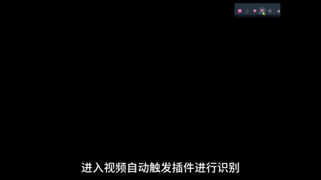

# VideoAdGuard — LLM-powered ad detection for Bilibili videos

> Detect embedded ads inside Bilibili videos with a language model, then skip them.
> [中文说明](./README.md) · [Live site](https://videoadguard.xiaobaozi.cn/) · [Demo video](https://www.bilibili.com/video/BV1UGeBztE2T/)

  

> Watch the full demo: [Bilibili BV1UGeBztE2T](https://www.bilibili.com/video/BV1UGeBztE2T/)

## What it does

Bilibili videos frequently contain **embedded ads** — product placements read by the creator, not
pre-roll. There is no way to skip them like a normal ad break.

VideoAdGuard reads the **subtitles** of the video, asks a large language model to find the
segments that are actually advertising, and marks them on the timeline so you can jump over them.

It is not a keyword filter. It understands the difference between *"I use this keyboard every day"*
(a genuine recommendation) and *"buy this product, link in the description"* (an ad).

## Features

- **Accurate detection** — an LLM analyses the subtitle track and locates the ad segments
- **Audio detection** — videos without subtitles can be analysed through the audio track (Groq)
- **One-click skip** — a "skip ad" button appears in the player; auto-skip is supported
- **Interactive marking** — click a highlighted range on the progress bar to toggle it
- **Smart cache** — results are cached locally, and a shared cloud cache lets the community reuse
  results across users
- **Multiple providers** — Zhipu AI, OpenAI, DeepSeek, Groq and others
- **Fully local** — supports a local Ollama model, so subtitles never leave your machine
- **Creator whitelist** — mark channels you trust and skip them
- **Broad support** — Edge, Chrome and Firefox

## Install

### Browser extension (recommended)

- [Edge Add-ons](https://microsoftedge.microsoft.com/addons/detail/videoadguard/mpfelbgplaolpbjmdbjjajonkmmgekgo/)
- [Chrome Web Store](https://chromewebstore.google.com/detail/videoadguard/nmkkpflniidbbodhjhjaijadbccidbgi/)
- [Firefox Add-ons](https://addons.mozilla.org/firefox/addon/videoadguard/)

### Userscript

A Tampermonkey version exists but is **no longer maintained** — use the extension on
Chromium-based browsers.

## Usage

1. Install the extension and click its icon to open the settings.
2. Enter your API key and pick a model (see the API configuration section below).
3. Open any Bilibili video that has subtitles — detection starts automatically.
4. When an ad is found, a "skip ad" button appears in the player and the range is marked on the
   progress bar.

## API configuration

| Setting | Notes |
| --- | --- |
| Provider | OpenAI / DeepSeek / Zhipu AI / Groq / Ollama (local) and more |
| Base URL | Custom endpoints are supported — point it at any OpenAI-compatible service |
| Model | Any chat model that follows the OpenAI API shape |
| Local model | Ollama is supported, so subtitles never leave your machine |

## Note on scope

VideoAdGuard targets **Bilibili**, the Chinese video platform. If you are not watching Bilibili,
this extension will not do anything for you — it is not a YouTube ad blocker.

## Contributing

Issues and pull requests are welcome. The project is TypeScript with a small build step
(`npm run build`), Vitest for tests, and a `worker/` directory for the shared cache service.

## License

GPL-2.0 — see [LICENSE](./LICENSE).
