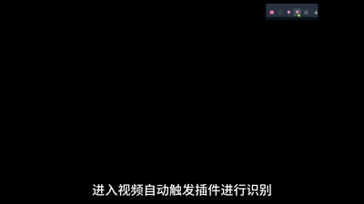

# VideoAdGuard - B站视频植入广告检测器

> [README.en.md](./README.en.md)

VideoAdGuard 是一个基于大语言模型的B站视频植入广告检测工具，能够自动识别B站视频中的植入广告内容，并提供跳过广告的功能。

如果你觉得这个插件有用，请给项目点个Star⭐支持一下！

<div align="center">
  
</div>

> 观看完整演示视频：[B 站 BV1UGeBztE2T](https://www.bilibili.com/video/BV1UGeBztE2T/)

<div align="center">
  

<!-- 浏览器插件下载 -->

<div style="margin-top: 20px;">
    <a href="https://microsoftedge.microsoft.com/addons/detail/videoadguard/mpfelbgplaolpbjmdbjjajonkmmgekgo/" target="_blank">
      
    </a>
    <a href="https://chromewebstore.google.com/detail/videoadguard/nmkkpflniidbbodhjhjaijadbccidbgi/" target="_blank">
      
    </a>
    <a href="https://addons.mozilla.org/zh-CN/firefox/addon/videoadguard/" target="_blank">
      
    </a>
  </div>
</div>

## News

- V1.4.3 新增 system one 模型，适配更多 B 站视频页面
- v1.4.0 新增云端缓存功能，支持社区共享检测结果和用户反馈
- v1.3.0 重构LLM模块，支持更多模型，包括Coding Plan
- v1.2.9~v1.2.11 添加手动控制广告区间，修复已知bug
- v1.2.8 提供Groq代理服务
- v1.2.7 适配Firefox浏览器
- v1.2.6 支持 glm-4.5 系列模型，适配 Chrome浏览器
- v1.2.5 优化缓存机制；优化av号处理
- v1.2.4 新增限制模式，仅在有商品链接时进行识别；优化界面
- v1.2.3 新增音频识别功能，支持无字幕视频检测；新增广告检测结果缓存机制
- v1.2.2 新增关闭插件开关，优化界面，优化广告判断逻辑
- v1.2.1 支持自定义UP白名单
- v1.2.0 支持自动跳过
- v1.1.3 支持本地Ollama模型

## 功能特点

- 🎯 **精准识别**：采用大语言模型分析视频字幕，准确定位植入广告内容
- 🎵 **音频识别**：支持无字幕视频的音频识别检测，使用免费的Groq服务商
- 🚀 **便捷操作**：检测到广告后自动显示跳过按钮，一键跳过广告片段
- 🔄 **自动跳过**：支持自动跳过已识别的广告内容
- 💾 **智能缓存**：本地缓存检测结果，大幅提升重复访问速度
- ☁️ **云端缓存**：社区共享检测结果，AI检测前优先查询云端缓存加速
- 🧠 **AI文案标注**：在视频信息区域选择「疑似 AI 文案」或「非 AI 文案」，结果会立即显示并同步到云端
- 💬 **AI评论屏蔽**：从评论原生菜单标记「疑似 AI 评论」，立即屏蔽该作者并共享 UID
- 🌈 **广泛兼容**：支持多种主流浏览器，包括Edge、Chrome等
- ⚙️ **灵活定制**：支持多种AI模型接入，包括智谱AI、OpenAI、DeepSeek等
- 🏠 **本地部署**：支持本地Ollama模型，保护隐私数据

## 安装方法

### 浏览器插件版（推荐）

点击上方对应浏览器的图标即可下载安装：

- **Edge浏览器**：[Edge插件下载](https://microsoftedge.microsoft.com/addons/detail/videoadguard/mpfelbgplaolpbjmdbjjajonkmmgekgo/)
- **Chrome浏览器**：[Chrome插件下载](https://chromewebstore.google.com/detail/videoadguard/nmkkpflniidbbodhjhjaijadbccidbgi/)
- **Firefox浏览器**：[Firefox插件下载](https://addons.mozilla.org/zh-CN/firefox/addon/videoadguard/)

### 油猴脚本版

**注意**：油猴版本由于功能限制后续不维护，chromium内核浏览器推荐采用插件版

1. 安装[篡改猴插件](https://www.tampermonkey.net/)
2. 从[GreasyFork](https://greasyfork.org/zh-CN/scripts/531743-b%E7%AB%99%E8%A7%86%E9%A2%91%E6%A4%8D%E5%85%A5%E5%B9%BF%E5%91%8A%E6%A3%80%E6%B5%8B%E5%99%A8-videoadguard/)安装脚本

## 使用方法

1. **浏览器插件版**：安装完成后，点击插件图标完成设置

   
2. **油猴脚本版**：安装完成后，进入B站视频页面，点击右下角齿轮图标进行设置

   
3. 设置API密钥和模型（详见下方API设置说明）
4. 打开任意带有字幕的B站视频，插件会自动检测广告内容
5. 当检测到广告时，会在视频播放器右下角显示"跳过广告"按钮

### 功能开关

- **开启广告检测**：执行广告检测，同时执行视频 AI 文案检测。
- **开启 AI 检测**：执行视频 AI 文案检测，并启用 AI 评论屏蔽。
- 两项都关闭时，插件停止当前页面的广告检测、AI 文案检测和 AI 评论屏蔽。

完整操作说明请查看[VideoAdGuard 使用教程](https://videoadguard.xiaobaozi.cn/guide/)。

### 三类检测与反馈

#### 广告检测

- 检测完成后，播放器右下角会出现「跳过广告」按钮。
- 进度条上的红色区间可以点击启用或停用，也可以拖动边缘调整起止时间，拖动中间移动整段区间。
- 直接点击右下角的「✗」会提交“不准确”反馈。
- 调整广告区间后再点击「✗」，会提交修正后的时间段，供社区复用。

#### AI 文案

- 视频信息区域出现文案标注后，点击「标注」。
- 选择「疑似 AI 文案」或「非 AI 文案」。角标会立即更新，本地结果会保留，云端同步在后台完成。
- 再次点击「修改」可以覆盖当前分 P 的标注。

#### AI 评论

- 在 B 站视频评论区打开目标评论右侧的「⋯」菜单。
- 点击「疑似 AI 评论」。评论会立即折叠，提交无需登录、输入理由或填写 UID。
- 首次有效提交就会进入共享名单，其他用户同步名单后会自动屏蔽该作者的评论。

三类反馈都在点击后立即更新页面，网络请求在后台完成。完整步骤和界面示例请查看[使用教程](https://videoadguard.xiaobaozi.cn/guide/)。

## API设置说明

本插件需要配置大语言模型API才能正常工作。检测能力与大模型能力强相关，推荐使用性能更强的大模型。

### 大语言模型API（必需）

插件支持多种SDK接入方式，可在设置页面中选择：

- **OpenAI 兼容**：适用于 OpenAI、智谱AI、MiniMax、Kimi、DeepSeek、硅基流动、阿里云百炼、火山方舟、阶跃星辰、百度千帆、302.AI 等
- **Anthropic 兼容**：适用于 Claude、智谱AI、MiniMax 等
- **System One**：TypeSafe、Vercel AI Gateway、OpenCode Console、火山方舟、Modelink、Right Code 等结构化决策接口
- **自定义 Fetch**：适用于 Ollama、LM Studio、vLLM 等本地模型

设置页面提供多平台预设，一键配置即可使用。

| SDK类型 | 支持平台                                          |
| ------- | ------------------------------------------------- |
| OpenAI 兼容 | Vercel AI Gateway、OpenCode Console、智谱AI、MiniMax、Kimi、DeepSeek、硅基流动、OpenRouter、OpenAI、Gemini、Grok、腾讯混元、阿里云百炼、火山方舟、阶跃星辰、百度千帆、302.AI、Requesty API 等 |
| Anthropic 兼容 | Vercel AI Gateway、OpenCode Console、Claude、智谱AI、MiniMax、腾讯云、阿里云、火山引擎、百度千帆 等 |
| System One | TypeSafe、Vercel AI Gateway、OpenCode Console、火山方舟、Modelink（大陆/海外）、Right Code |
| 自定义 Fetch | Ollama、LM Studio、vLLM、llama.cpp、LocalAI、Xinference、FastChat、Jan、One API 等 |

> **注意**：使用本地模型时，如遇跨域问题，需设置环境变量，如 `OLLAMA_ORIGINS = *`

### System One 设置

1. 在 SDK 下拉菜单选择 **System One**。
2. 从基础地址下拉菜单选择服务商。插件会填写该服务商的默认模型，并记住你为每个地址设置的密钥与模型。
3. 填入对应服务商的 API 密钥，也可以手动填写账户可用的模型名称。

| 服务商 | 基础地址 | 默认模型 | 接口资料 |
| --- | --- | --- | --- |
| TypeSafe | `https://api.typesafe.ai/v1` | `jev-latest` | [官方接口](https://docs.typesafe.ai/api/system-one) |
| Vercel AI Gateway | `https://ai-gateway.vercel.sh/typesafe/v1` | `typesafe-ai/jev` | [TypeSafe 兼容接口](https://vercel.com/docs/ai-gateway/sdks-and-apis/typesafe) |
| OpenCode Zen | `https://opencode.ai/inference/systemone/v1` | `jev-1.13` | [模型与接口](https://opencode.ai/v2/docs/console/models/) |
| 火山方舟 | `https://ark.cn-beijing.volces.com/api/v1` | `doubao-seed-2-1-lite-260915` | [System One 接口](https://console.volcengine.com/ark/region:cn-beijing/docs/system-one-api) |
| Modelink（中国大陆） | `https://api.qnaigc.com/v1` | `jev-latest` | [Jev 接口](https://docs.modelink.ai/models-capabilities/model-jev) |
| Modelink（海外） | `https://api.modelink.ai/v1` | `jev-latest` | [Jev 接口](https://docs.modelink.ai/models-capabilities/model-jev) |
| Right Code | `https://www.rightapi.ai/v1` | `jev-latest` | [Jev 接口](https://docs.right.codes/docs/rc_jev/) |

### 音频识别API（可选）

- **用途**：用于无字幕视频的音频识别功能
- **推荐服务**：目前只支持Groq（免费Whisper模型）
- **API密钥获取**：在[Groq平台](https://console.groq.com/keys)注册并获取
- **注意**：如果要使用Groq API，需要特殊网络环境，也可勾选“官方接口失败时使用代理”走我的反代


## 目录结构

```tree
VideoAdGuard
├── builds/                        # 构建产物（按浏览器区分）
│   ├── chrome/                    # Chrome 打包目录
│   └── firefox/                   # Firefox 打包目录
├── src/                           # 源代码目录
│   ├── background.ts             # 后台脚本（跨域代理）
│   ├── content.ts                # 内容脚本（广告检测逻辑）
│   ├── popup.ts/.html            # 弹窗设置界面
│   ├── services/                  # 业务逻辑
│   │   ├── ai.ts                 # AI 检测提示词与解析
│   │   ├── bilibili.ts           # B站 API 客户端
│   │   ├── cache.ts              # 本地缓存服务（24h TTL）
│   │   ├── cloud-cache.ts        # 云端缓存服务（Cloudflare KV）
│   │   ├── whitelist.ts          # UP主白名单
│   │   ├── audio.ts              # 音频识别（浏览器适配）
│   │   └── llm/                   # LLM 提供商抽象
│   │       ├── config.ts         # 提供商解析
│   │       ├── providers.ts      # OpenAI/Anthropic/Custom Fetch
│   │       └── types.ts          # LLM 类型定义
│   ├── utils/                     # 工具函数
│   │   ├── wbi.ts                # B站 WBI 签名
│   │   ├── errors.ts            # 错误规范化
│   │   └── logger.ts            # 日志工具
│   └── types/                     # TypeScript 类型定义
│       └── cloud-cache.ts        # 云端缓存类型定义
├── worker/                        # Cloudflare Worker（云端缓存网关）
│   ├── src/index.ts              # Worker 入口，API 路由
│   ├── wrangler.toml             # Worker 配置
│   ├── package.json              # Worker 依赖
│   └── README.md                 # 部署文档
├── manifests/                     # 浏览器清单文件
│   ├── manifest-chrome.json      # Chrome 清单
│   └── manifest-firefox.json     # Firefox 清单
├── _locales/                      # i18n 资源
├── icons/                         # 插件图标资源
├── scripts/                       # 构建脚本
├── VideoAdGuard.Tampermonkey.js   # 油猴脚本版本（已停止维护）
├── webpack.config.js              # Webpack 构建配置
├── tsconfig.json                  # TypeScript 配置
├── package.json                   # 项目依赖与脚本
├── CLAUDE.md                      # Claude Code 指南
├── LICENSE                        # 开源许可证
└── README.md                      # 项目说明文档
```

## 自行构建

如果你想自行构建VideoAdGuard，可以按照以下步骤进行：

1. 克隆本仓库到本地：
   ```bash
   git clone https://github.com/ZeroTang05/VideoAdGuard.git
   cd VideoAdGuard
   ```
2. 安装依赖：
   ```bash
   npm install
   ```
3. 构建插件：
   ```bash
   npm run build
   ```

## 开源与贡献

本项目完全开源，欢迎贡献代码和提出建议：

- GitHub仓库：[https://github.com/ZeroTang05/VideoAdGuard](https://github.com/ZeroTang05/VideoAdGuard)
- 问题反馈：[GitHub Issues](https://github.com/ZeroTang05/VideoAdGuard/issues)
- 如遇任何插件不起作用问题，在提出Issues同时，附上浏览器(F12)控制台的错误日志/截图，以便我们更好地帮助你。
- 

### 贡献者

<a href="https://github.com/ZeroTang05/VideoAdGuard/contributors">
  </a>

## 免责声明

本插件仅用于学习和研究目的，不得用于任何商业或非法用途。使用本插件所产生的一切后果，与作者和插件开发者无关。

---

## 许可证

本项目采用GPLv2许可证开源。

## Star History

<a href="https://www.star-history.com/#ZeroTang05/videoadguard&Date">
 <picture>
   <source media="(prefers-color-scheme: dark)" srcset="https://api.star-history.com/svg?repos=ZeroTang05/videoadguard&type=Date&theme=dark" />
   <source media="(prefers-color-scheme: light)" srcset="https://api.star-history.com/svg?repos=ZeroTang05/videoadguard&type=Date" />
   
 </picture>
</a>
